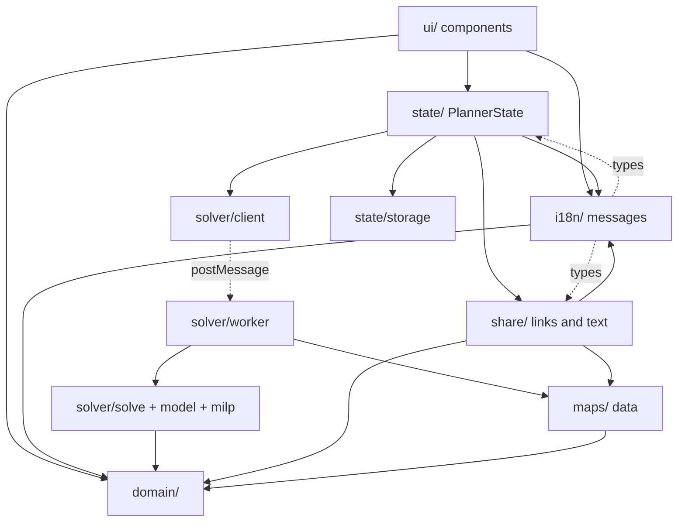

# Architecture

This is the overview of how Ragnapax works and why it is built the way it
is, for the maintainer, for contributors and for AI agents working on the code.
Each part of the app has a document of its own:

- [Rules and the solver](SOLVER.md): maps, rules, settings and priorities, the
  optimisation model and the solver worker.
- [Share links and saved data](SHARING.md): the link format, opening links, and
  what is stored on the device.
- [The interface](UI.md): components, the map drawing, spacing, themes,
  accessibility and languages.
- [Privacy](PRIVACY.md): what the privacy notice rests on, and what a fork or
  another host must change.
- [Building, testing and running](OPERATIONS.md): offline caching, security, the
  performance budget, browser support, testing, CI and deployment, crawlers
  and AI agents.
- [Translating](TRANSLATING.md): how to translate the interface.

Keep them current: fix what a change makes wrong in the same commit, as
"Keeping the docs true" in [AGENTS.md](../AGENTS.md#keeping-the-docs-true)
describes.

## What the app does

In Ragnarok, a game mode of _Tokyo Debunkers_ (a mobile game published by
ZigZaGame Inc.), four guilds in a group fight over a map of towns, dorms
(dormitories) and the castle (Darkwick Castle). The official name is _Game Of
Claws: Ragnarok_; players say Ragnarok, Ragna or Rag. The game calls every
town, dorm and castle a **kingdom**, and so does the code. Holding a
kingdom earns points every day. Guilds often agree to **share points** instead of fighting: every
guild declares on kingdoms in a pre-agreed order so that everyone ends up
with the same reward. Working such a schedule out by hand is slow and
error-prone.

How Ragnarok runs, which the app takes as given:

- Each Ragnarok lasts one week, from **Wednesday to Monday**. On Tuesday the
  game only shows last week's results.
- Each day follows the same phases, in server time. The **declare phase**
  runs from 11:00 to 21:00: each guild may make up to three declares, which
  cannot be taken back, and the game never lets two guilds declare on the same
  kingdom. The preparation phase follows, then the **battle phase** from 22:00
  to 22:45, after which the day's rewards are paid.
- Wednesday also has an **opening phase** first: starting positions are drawn
  at midnight and visible a few minutes later, until declares open at 11:00.
  That is when groups plan, so Wednesday is both the starting day (day 0 in the
  code) and the first day of declares and captures (day 1).
- **Every group plays the same map** in a given week.
- The game **assigns starting towns at random** in each group, so there is no
  pattern to exploit: players tap in the towns they were given.
- Points never vary by map: 1 a day for a town, 2 for a dorm, 3 for the castle.

Ragnapax does it automatically:

1. During Wednesday's opening phase, the user names the four guilds and taps
   each guild's starting towns on the map, or, if they prefer, picks each
   town's guild from a list, as in a spreadsheet.
2. They pick a goal (equal resources, the default, or equal points) and
   optionally ask to use every kingdom. Under "Advanced options", they can
   mark guilds the game put in the group that do not play: those are left
   alone and left out of the share. They can also ask for declares on as
   few days as possible, rather than as few declares as possible, or set
   by hand how many days each guild holds towns, dorms and the castle,
   instead of the goal.
3. A mixed-integer optimiser finds the declarations for every guild on every
   day, and proves whether the result is the fairest possible.
4. The plan is shown as a day-by-day map replay with per-guild lists of declares,
   or as one list of the whole week's declares, and
   shared as a link or as text for game or Discord chat. One person plans for
   the whole group and the others only open the link, so they never download
   the solver. The interface asks them to follow the shared plan rather than
   plan again: two people planning the same setup may get different plans,
   equally fair, and the group needs one.
5. When a day does not go to plan (a guild declares on the wrong kingdom, or
   forgets to declare), the player who planned records how it went, plans the
   rest of the week from there, fair over the whole week, and shares the new
   plan.

## Constraints that shape everything

These come from the audience, players of a mobile gacha game, and are
non-negotiable:

| Constraint                                        | Consequence                                                                                                                     |
| ------------------------------------------------- | ------------------------------------------------------------------------------------------------------------------------------- |
| Phones about five years old                       | Small JavaScript, no heavy framework, solver in a worker, solves stop as soon as the result is proven good enough.              |
| Mostly Wi-Fi or 4G/5G, but usable on 3G           | A first visit well under 100 KB gzipped; the solver, over a megabyte, downloads only when someone starts planning, and is cached for good. |
| Everything client-side                            | A static site: no server, no accounts, no analytics. Plans travel in URL fragments, which browsers never send to servers.       |
| Three maps, with different towns, dorms and roads | Maps are data. Nothing outside `src/maps/` knows a kingdom name.                                                                |
| Players share plans in chat                       | Links are short, versioned and checked against the rules when opened. Plain-text export exists for chat apps that mangle links. |
| A plan only matters for one week                  | Links need to last from Wednesday to Monday; breaking changes ship on a Tuesday (see "Share links").                            |

## Technology stack

| Concern          | Choice                                                                                                    | Why                                                                                                                                   |
| ---------------- | --------------------------------------------------------------------------------------------------------- | ------------------------------------------------------------------------------------------------------------------------------------- |
| Language         | TypeScript (strict, `noUncheckedIndexedAccess`)                                                           | The domain is index-heavy; the compiler catches off-by-ones and missing cases.                                                        |
| UI               | [Svelte 5](https://svelte.dev) with runes                                                                 | Compiles to small vanilla JS with a small runtime. Runes give fine-grained reactivity for derived plan data. |
| Build            | [Vite 8](https://vite.dev)                                                                                | Fast dev server, hashed assets, first-class workers and wasm. Small custom plugins live in `vite.config.ts`.                          |
| Optimiser        | [HiGHS](https://highs.dev) via [`highs`](https://www.npmjs.com/package/highs) (WebAssembly)               | Proves optimality, fast branch-and-cut MIP, maintained, MIT-licensed, callbacks for streaming incumbents.                             |
| Unit tests       | [Vitest 5](https://vitest.dev) with [happy-dom](https://github.com/capricorn86/happy-dom) for state tests | Shares Vite's config and transforms.                                                                                                  |
| End-to-end tests | [Playwright](https://playwright.dev), Chromium as a Pixel 5 and WebKit as an iPhone 13                    | Drives the real production build, service worker and CSP included.                                                                    |
| Lint and format  | [xo](https://github.com/xojs/xo) with eslint-plugin-svelte, `svelte-check`                                | One tool for rules and formatting: xo's own style (tabs, single quotes), no Prettier, and eslint-plugin-svelte's for markup. Exceptions are in `xo.config.js`. |
| CI and hosting   | GitHub Actions; GitHub Pages                                                                              | Free, static, HTTPS. Any static host works.                                                                                           |
| Runtime | Node.js 26.12.1+ for development only; npm refuses older ones (`engine-strict` in `.npmrc`), as the minimum rises with security releases | Nothing runs on a server. |

No CSS framework, icon font or UI kit: the design system is a page of CSS
custom properties in `src/app.css`, and icons are inline SVG paths in
`src/ui/Icon.svelte`. Both keep the download small.

## Repository layout

```text
.github/workflows/ci.yml   Lint, types, tests, audit, REUSE, build and size, e2e, deploy to Pages
bench/                     Solver benchmark (npm run bench)
docs/ARCHITECTURE.md       This file: the overview
docs/SOLVER.md             Rules, the model and the solver worker
docs/SHARING.md            Share links and saved data
docs/UI.md                 The interface and languages
docs/PRIVACY.md            What the privacy notice rests on
docs/OPERATIONS.md         Caching, security, size, browsers, tests, CI
docs/TRANSLATING.md        Guide for translators
e2e/                       Playwright end-to-end tests
CHANGELOG.md               What changed for players in each release
LICENSE                    The AGPL-3.0, where GitHub and people look for it
LICENSES/                  The same, where the REUSE specification looks for it
public/                    Copied into the build: icon, web app manifest, robots.txt, llms.txt
scripts/i18n-status.ts     Translation progress (npm run i18n:status)
scripts/icons.ts           Draws the PNG icons from public/icon.svg at build time
scripts/rotation-anchor.ts Moves the map rotation's anchor (npm run rotation:anchor)
scripts/size.ts            First-visit and solver sizes of the build (npm run size)
src/
  main.ts                  Mounts the app, registers the service worker
  App.svelte               Page layout; wires state to components
  app.css                  Design tokens and global styles
  service-worker.js        Template for dist/sw.js (see "Offline and caching")
  env.d.ts                 Build-time constants
  domain/                  Pure game logic: no UI, no solver, no browser APIs
    types.ts               Map definition types, kingdom kinds, VACANT
    map.ts                 Map validation and compilation into an indexed graph
    plan.ts                Setups, plans, rules engine (simulate) and scoring
    settings.ts            Goals, options and the planner's priority order
    calendar.ts            Day of the Ragnarok and week of the rotation, by the device's clock
  maps/                    One data file per map
    index.ts               Every map, the default and the weekly rotation
    kingdoms.ts            Town, dorm and castle helpers; dorm short names
  solver/                  Optimisation model, HiGHS integration, Web Worker
    milp.ts                Tiny MILP builder that folds constants into bounds
    model.ts               The point sharing model
    solve.ts               Runs HiGHS with callbacks and the early-stop policy
    protocol.ts            Worker message types
    worker.ts              Worker entry point
    client.ts              Promise API over the worker, with cancellation
  share/                   Share links and plain-text export
  i18n/                    Interface text: English catalogue, translations, formatting
  state/                   Application state (runes) and on-device storage
  ui/                      Svelte components
  test/                    Shared test data and helpers, and repository-wide tests
    fixtures.ts            Shared test data
    random.ts              Seeded random openings, for tests and the benchmark
    color.ts               Colour maths for the accessibility tests
    docs.test.ts           The docs' promises, checked against the code
    icons.test.ts          The PNG icons drawn from public/icon.svg
vite.config.ts             Build, worker format, service worker and CSP plugins, tests
vitest.bench.config.ts     Benchmark-only test configuration
playwright.config.ts       End-to-end test configuration
REUSE.toml                 Copyright and licence of files that cannot carry SPDX headers
```

## Module structure

Dependencies point one way. The domain is the foundation and knows nothing
about anything else; the UI sits on top and only talks to `PlannerState`.
The one exception is type-only: `i18n/describe.ts` names types from
`share/` and `state/` (link problems, solve phases, plan quality) to word
them, which brings in no code.



Rules of thumb:

- `domain/` is pure TypeScript with no browser APIs, so it runs in the page,
  the worker and tests alike. It returns data, never sentences: rule
  violations and link problems are codes that `i18n/describe.ts` words in the
  player's language.
- Components never touch storage, links or the solver directly; they read
  `PlannerState` fields and call its methods.
- The worker receives a map **id**, not a map, and looks it up itself. Maps are
  code, so both bundles contain them, and nothing large is copied between
  threads.

## Application state

`PlannerState` (`src/state/planner.svelte.ts`) is a class using Svelte runes.
One instance is created in `App.svelte` and passed to components. Two
helpers keep it to the setup and its plan:

- `Solving` (`src/state/solving.svelte.ts`) runs one solve at a time and
  tracks its phase (`idle`, `solving`, `failed` and why), whether the solver
  has loaded, and whether the running solve has proven its plan. It hands
  each plan found to `PlannerState`, which checks it with `simulate` and
  keeps it; a plan that breaks a rule stops the solve and is reported.
  `PlannerState.solve` and `solverReady` read through to it.
- `AddressBar` (`src/state/address.ts`) writes the address bar, retrying
  when Safari refuses too many changes in a few seconds.

- **Inputs** (`$state`): map, guild names, starting towns, goal, fillMap,
  castleLast, the guilds sitting out (`inactive`), fewestDays, the holdings
  set by hand (`targets`), and the days recorded as played (`played`).
- **View** (`$state`): `isSetupOpen`, whether the setup is shown or put away,
  and `townLists`, whether starting towns are set from lists rather than on
  the map: the player's own preference, saved on the device for every map
  and never in links, since guilds in the same group may set up differently.
- **Result** (`$state.raw`): the plan plus the start, settings and input key it
  was made for, and its quality, known only for plans the solver made in
  this visit. Raw state avoids deep proxies on large immutable data, which
  matters on slow phones.
- **Derived** (`$derived`): setup status, display names (blanks become
  "Guild N"), starting ownership, `history` (the position after each day
  played), `nextDay` (the day that can be recorded next, never Monday),
  `lastPlannedDay` (the last day that can be recorded as planned, while the
  plan agrees with every day recorded), the
  timeline and scores, `disturbance` (the first declare, after the days
  played, that does not leave a guild sitting out alone), `stale` (inputs
  changed since the plan was made), `isBest` (up to date and proven best),
  `excessTargets` (kinds whose holdings set by hand add up to more days
  than the map has),
  `isReceived` and `openedFromLink`, and the
  serialised forms: `ownFragment` and `address`.
- **Actions:** `restore`, `switchMap`, `toggleTown`, `assignTown`, `clearTowns`, `setGuildName`,
  `finishGuildName`, `editSetup`, `setGoal`, `setFillMap`, `setCastleLast`,
  `setSittingOut`, `setFewestDays`, `setTargets`, `setTarget`, `setTownLists`, `recordDay`,
  `recordAsPlanned`, `forgetDay`, `planAnotherGroup`,
  `warmUpSolver`, `findPlan`, `stop`, `cancel`, `shareUrl`, `persist`,
  `forgetEverything`, `sync`.

Guild names are kept to the game's limit of 9 characters as players see
them (`cutGuildName`, by grapheme, so an emoji or a kanji counts as one
however many bytes it takes) while they are typed, except in the middle of
an IME composition, which cutting would break. They lose surrounding spaces
(`cleanGuildName`) when the player leaves the field, and whenever a link is
made or read, since phone keyboards add a space after a suggested word.

A plan stays on screen when the setup changes, marked out of date with an
"Update" button, rather than disappearing. (It is not dimmed: faded text
would fall below WCAG contrast.) Renaming guilds does not
make a plan stale, since names are only labels. Share and Copy as text are
disabled while a plan is out of date: the text has no starting towns, so
readers could not tell it no longer fits the map.

The starting towns cannot be changed while a solve runs and has not yet
proven its plan fairest (`townLock`, which `toggleTown`, `assignTown` and
`clearTowns` obey and the setup card shows): a tap would put the plans still to come
out of date. "Cancel" or "Use this plan" unlocks them. Once the plan is
proven, only declares are left to trim, which can take a while on an old
phone, so the towns unlock: a change stops the solve and keeps the proven
plan, marked out of date as after any change. They are locked while days
are recorded as played too, since those days were played from them.

Once there is a plan (found, stopped with "Use this plan", or loaded from a
link or storage) the setup is put away behind "Edit setup", as for a shared
plan, so a stray tap on the map cannot put the plan out of date. Planning
again puts it away again. While the plan is up to date and proven best
(`isBest`), a warning above "Plan again" says so: solving again could at
most find an equally fair plan, replacing the proven one with interim plans
while it searched. The button still works, for anyone who wants another
equally fair plan; the warning mostly reminds players to change the setup
first.

Beside "Edit setup", "Plan for another group" (`planAnotherGroup`) is for
players who plan for more than one group, such as one for each guild they
are in. After asking, it clears the guild names, starting towns, days
recorded and plan, and keeps the map, goal and options. Guilds sitting out
are cleared too: they belong to the group, and kept on they would quietly
leave a guild out of the next group's share. The cleared setup replaces the
one saved for the map, as any change would.

`sync()` installs an effect that reads the derived `address` and
`ownFragment` values and writes them to the address bar and storage (see
[Opening links](SHARING.md#opening-links)). Because both are derived, every input that
matters is tracked automatically, with no hand-written dependency list to
forget an option. The address bar follows
every change at once; saving waits for half a second without changes
(`DelayedSave` in `src/state/storage.ts`), since typing a name or a stream
of plans would otherwise write storage several times a second, and is made
at once when the page is hidden or closed. "Delete saved data" drops a save
still waiting, which would otherwise bring the setup back.

## How to extend

- [Add a map](SOLVER.md#add-a-map)
- [Add a plan setting](SOLVER.md#add-a-plan-setting)
- [Change the rules engine or model](SOLVER.md#change-the-rules-engine-or-model)
- [Add or change interface text](UI.md#add-or-change-interface-text)

## Decision log

Short records of the choices that are not obvious from the code.

1. **Static, client-only site.** No running costs, nothing to secure or keep
   up, works offline, and plans never leave the players' devices except as
   links they share themselves.
2. **Svelte 5 rather than React, Vue or plain DOM code.** The smallest output
   among mainstream frameworks, matters on 3G; runes make derived plan data
   simple. Plain DOM code would be smaller still but much harder to keep
   correct as the interface grew.
3. **An exact MILP solver rather than a heuristic.** Players need to trust that
   a plan is fair; HiGHS can prove it. A heuristic could be faster but could
   not say "nothing fairer exists". HiGHS is among the fastest open-source MIP
   solvers and its WebAssembly build exposes the callbacks the early stop needs.
4. **One weighted solve with an early stop, rather than solving priorities in
   sequence.** One run streams incumbents to the interface throughout, and the
   0.5 tie-breaker budget turns "proven" into a simple test on the gap.
5. **Plans in the URL fragment; storage reuses the link format.** No server
   needed to share; fragments are private to the browser; one validated format
   for both.
6. **The address bar holds the live setup; links sent to others say so.**
   The Share button marks links with `s=1`, so a received plan is told from
   the reader's own without comparing it with what the device saved, and is
   never saved over the reader's setup until they make it their own.
7. **Hand-written service worker generated per build, not Workbox.** One
   short file instead of a library, with the exact behaviour needed: precache only the
   small shell, cache the solver lazily, prune by manifest. The page is served
   from the cache first, so it opens at once on any connection; the update
   banner makes up for showing the last installed version.
8. **Baseline Widely Available as the browser target, with a module worker.**
   It is a published, dated standard rather than a list of versions picked
   by hand, and it covers the audience: iPhones from 2018 and every Android
   phone that still gets Chrome updates. It also keeps Svelte's private
   class fields native, which saves 1.7 KB gzipped on the first visit.
9. **Guild order as a hard constraint when filling the map.** Cheap, always
   feasible, and avoids huge objective weights a soft version would need.
10. **Drawn maps, not game artwork.** Game assets are not allowed (see
    CONTRIBUTING), so maps are drawn from coordinates. Positions approximate the
    game, not reproduce it: the drawing keeps every kingdom's place relative to
    the others and stretches the rest to fill the screen, since only adjacency
    matters to the planner.
11. **Our own message format rather than an i18n library.** The app needs
    placeholders, plurals and bold, which take a few lines over
    `Intl.PluralRules`; libraries with ICU parsers cost several kilobytes on
    3G. Catalogues are TypeScript rather than JSON so English can carry notes
    for translators and the compiler can check every key and placeholder.
12. **Days played are recorded as positions, one day at a time.** Fairness is
    over the whole week, so the planner needs every day's holdings, not just
    today's map or the points so far. Recording each day as the map at its
    end, starting from the plan, keeps that to a few taps, and lets the rules
    engine check every day, so a recorded week is as trustworthy as a planned
    one.

## Known limitations and ideas

- English only so far: the other eight languages are set up and waiting for
  translators (see [TRANSLATING.md](TRANSLATING.md)).
- A translation is cached when first used. If a new version is installed
  in the background and the next visit is offline, the new translation file is
  not cached yet, and the page shows English until the next visit online.
- End-to-end tests run Playwright's current WebKit, not the oldest Safari in
  the target, so they catch WebKit behaviour but not missing features.
- Declarations are assumed to succeed. When one does not, players record the
  day as it went and plan the rest of the week again; plans for alliances that
  actually fight are out of scope.

## Glossary

| Term          | Meaning                                                                                                   |
| ------------- | --------------------------------------------------------------------------------------------------------- |
| Ragnarok      | The weekly game mode this app plans for (also Ragna or Rag).                                              |
| Group         | The four guilds that play one Ragnarok together.                                                          |
| Kingdom       | A town, dormitory (dorm) or the castle (Darkwick Castle) on the map.                                      |
| Vacant        | Held by nobody. Written with a capital V, as in the game.                                                 |
| Declaration   | A guild's claim on a kingdom for one day; it takes the kingdom. The game and interface say "declare".     |
| Kingdom-day   | One kingdom held for one scored day, e.g. "castle-days".                                                  |
| Point sharing | Agreeing on declarations so every guild gets the same reward.                                             |
| Setup         | Guild names, starting towns, goal and options for one map.                                                |
| Sitting out   | A guild in the group that does not play: it makes no declares, nobody declares on it, and it is not part of the share. |
| Plan          | Every guild's declarations for every day.                                                                 |
| Proven        | The solver showed nothing better exists for every priority.                                               |
