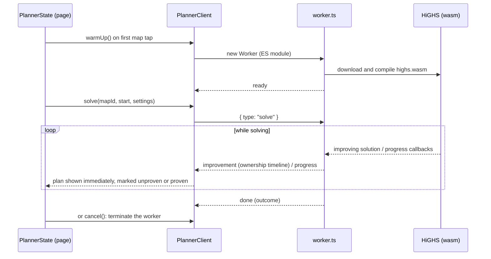

# Rules and the solver

How the game's rules are modelled, how the solver turns them into a fair plan,
and how it runs in the browser. Read it before changing a map, a rule, a
setting or the model. Part of the architecture docs;
[ARCHITECTURE.md](ARCHITECTURE.md) is the overview.

## Domain model

### Maps

A map is declared as data (`MapDefinition` in `src/domain/types.ts`):
kingdoms with an id, kind (`town`, `dormitory` or `castle`), display
name, short label and schematic `x`/`y` coordinates, and undirected roads
between kingdom ids. Map files build kingdoms with `town`, `dorm` and
`castle` from `src/maps/kingdoms.ts`, which hold what is the same on every
map: towns are "Town A" labelled "A", each dormitory has one name and short
name (Dionysia is always "Dio"), and the castle is always Darkwick Castle. Every
map has exactly one castle. The rules are the same on every map, so they are
not map data (see [Rules](#rules)).

**One map a week.** Every group plays the same map in a given week, in a
fixed rotation: The Galaxy Terminal, The Sea of Poseidon, then The Floating
City (which players call "Sky"). `ROTATION` in `src/maps/index.ts` holds the
order, and `mapOfWeek` counts weeks from one known to be the Sea's, the week
from Tuesday 20 October 2026 (`ragnarokWeek` in `src/domain/calendar.ts`).
Weeks turn on Tuesday by the device's calendar, when the last Ragnarok only
shows its results. A visit without a link opens on that week's map, as it
was last set up on the device; a link opens on its own map, and the picker
switches to any other.

Every group has **exactly four guilds**, a fact of the game rather than a
map setting: `GUILD_COUNT` and `GUILDS` in `src/domain/types.ts`. The solver,
share links, guild colours and interface all assume four.

`compileMap` (`src/domain/map.ts`) validates a definition (`findMapProblems`
lists every problem in plain language) and turns it into a `GameMap`:
kingdoms get dense integer indices and sorted neighbour lists, so all later
code works with arrays rather than id lookups. A map may have at most 62
kingdoms (`MAX_TERRITORIES`), since share links use one character each.

Share links do not use indices. They name each kingdom by its place in
`linkOrder`: towns first, then dorms, then the castle, each kind sorted by
id. So links depend on the ids alone, and reordering a map file breaks
nothing, but renaming, adding or removing a kingdom moves the others and
breaks every link for that map. The maps copy the game, so that only happens
if the game changes a map, which is a breaking change anyway. `maps.test.ts`
pins every map's ids in link order.

Indices themselves keep the map file's order, because the solver's speed
depends on the order of its variables. Numbering kingdoms in link order
made the same plans, but on 120 benchmark openings the slowest proof went
from 3 seconds to 30, and the slowest solve from 7 seconds to a minute.

Coordinates follow the in-game layout, in any unit: what matters to players is
which kingdom lies left of, right of, above or below which, not the distances
between them. Only roads affect planning. The drawing stretches each axis
separately to fill the map (see [Drawing the map](UI.md#drawing-the-map)).

### Rules

Ragnarok's rules are the same on every map, so they are constants in
`src/domain/types.ts` rather than map data:

- `DAY_NAMES` and `DAYS`: six scored days, Wednesday to Monday, after the
  starting position (day 0). Day 1 is Wednesday, which is both the day the
  starting towns are revealed and the first day of declares.
- `MAX_DECLARATIONS_PER_DAY`: each guild may declare on up to 3 kingdoms a
  day.
- `POINTS`: a held kingdom earns 1 (town), 2 (dorm) or 3 (castle) points per
  scored day.
- `TOWNS_PER_GUILD`: each guild starts on 4 towns, so a map needs at least 16.

Rules of Ragnarok that the planner encodes:

- A guild can only declare on a kingdom next to one it held the day before.
- A declaration always succeeds: guilds use the plan to agree who takes what,
  so nobody defends.
- Two guilds never declare on the same kingdom on the same day; the game
  does not allow it.
- Each guild starts on `TOWNS_PER_GUILD` towns; every other kingdom starts
  **Vacant** (the game's word, capitalised in the interface).
- Once someone holds a kingdom it never becomes Vacant again.

### Setups, plans and timelines

All in `src/domain/plan.ts`:

| Type            | Meaning                                                                                                        |
| --------------- | -------------------------------------------------------------------------------------------------------------- |
| `StartingTowns` | Town id to guild index. Unlisted towns are Vacant.                                                             |
| `Ownership`     | Owner of every kingdom by index, or `VACANT` (−1), at one moment.                                              |
| `Plan`          | `declarations[day − 1][guild]`: the kingdom indices each guild declares on that day. This is what is shared.   |
| `Timeline`      | `owners[day]` for days 0 to 6, plus `violations`. Derived from a plan by `simulate`.                           |
| `GuildScore`    | Points, points per day, kingdom-days held per kind and number of declarations.                                 |

`simulate(map, start, plan)` is the **rules engine**. It replays a plan and
reports every rule broken as a `Violation` (the rule, day, guilds and
kingdom), which `describeViolation` puts into words. Everything that enters the app
goes through it: solver output (a solver bug becomes a visible error rather
than a wrong plan), share links and saved data. `planFromTimeline` turns the
solver's ownership timeline back into declarations.

`replay` is the same engine for any run of days from any position, which
`simulate` uses for the whole week. Two helpers serve
[recording days as played](UI.md#recording-days-as-played): `followPlan` applies
a day's planned declarations as far as the rules still allow, and
`dayBetween` works out the declarations between two positions and any rule
they break.

### Settings and priorities

`src/domain/settings.ts` holds `PlanSettings` (`goal`, `fillMap` and
`castleLast`), their
labels, and `priorities(settings)`: what the planner optimises, most important
first, each proven optimal; and `refinements(settings)`: tie-breakers the
solver improves while polishing but does not prove. Together they are the single
source of truth for both the solver and the "How plans are ranked" disclosure in
the interface.

| Priority | Equal points                   | Equal resources                | Either goal + Use every kingdom   |
| -------- | ------------------------------ | ------------------------------ | --------------------------------- |
| 1        | Smallest gap in points         | Smallest gap in castle-days    | Most points for everyone combined |
| 2        | Most points for everyone       | Smallest gap in dormitory-days | then the goal's gaps, in order    |
| 3        | Smallest gap in castle-days    | Smallest gap in town-days      |                                   |
| 4        | Smallest gap in dormitory-days | Most points for everyone       |                                   |
| Polished |                                |                                | Equal resources: gap in points    |
| Last     | Fewest declarations            | Fewest declarations            | Fewest declarations               |

Why the holding gaps under equal points: equal points alone allowed plans where
one guild held the castle all week and made the difference up with towns, which
no alliance accepts as fair.

With **Use every kingdom**, guild points must not increase down the guild
list (`guildOrders`), so any uneven remainder goes to the first guilds.
This is a hard constraint, which is safe: a Ragnarok in which nobody declares
gives every guild identical totals, so it can never make the problem infeasible.
Once days are recorded as played that no longer holds (a guild may already be
too far ahead to be caught), so the order is dropped and extras go wherever
they fit.

Equal resources then refines the points gap, so leftover days of different
kinds go to different guilds: two extra castle-days and two extra town-days
go to four different guilds, castle first, rather than all to the first.
It is a refinement rather than a priority because proving it took up to two
minutes on some Floating City openings, against about a second without it;
polishing reaches the best spread on every benchmark opening.

**Extra castle days last** (`castleLast`, only offered with Use every
kingdom) adds a second order: castle-days must not decrease down the guild
list, so when the castle cannot be shared evenly its extra days go to the last
guilds. Points still must not increase, so the first guilds make up the
difference with other kingdoms. Like the points order, it is a hard
constraint that doing nothing always satisfies, and it is dropped once days
are recorded as played.

## The planner

### Formulation

`buildModel` in `src/solver/model.ts` writes a mixed-integer linear program
through the small `MilpBuilder` (`src/solver/milp.ts`), which lets constraints
mention known constants and folds them into row bounds.

Variables, for guild _g_, scored day _d_ and kingdom _t_:

- `own[g,d,t]` ∈ {0, 1}: _g_ holds _t_ at the end of day _d_. Day 0 is the
  fixed starting position. **Reachability pruning:** a guild only expands into
  neighbours, so by day _d_ it cannot be more than _d_ roads from its start;
  those variables are the constant 0 and never reach the solver. On The
  Floating City 477 of 600 ownership variables remain; maps with more kingdoms gain more.
- `gain[g,d,t]` ∈ `[0, 1]`, continuous: _g_ declares on _t_ on day _d_. The
  constraints pin it to exactly 0 or 1, so it needs no integrality.
- `most_m`, `least_m`, free: bounds on every guild's total of measure _m_, one
  pair per gap objective.

Constraints:

```text
Σ_g own[g,d,t] = 1                          t held at start (someone always holds it)
Σ_g own[g,d,t] ≤ 1                          t Vacant at start
Σ_g own[g,d,t] ≥ Σ_g own[g,d−1,t]           never back to Vacant
own[g,d,t] − own[g,d−1,t] ≤ gain[g,d,t]     gaining needs a declaration
gain[g,d,t] ≤ own[g,d,t]                    a declaration gains it
gain[g,d,t] + own[g,d−1,t] ≤ 1              no declaring on your own kingdom
gain[g,d,t] ≤ Σ_{n ∈ N(t)} own[g,d−1,n]     adjacency to yesterday's holdings
Σ_t gain[g,d,t] ≤ MAX_DECLARATIONS_PER_DAY   declaration limit
least_m ≤ total_m(g) ≤ most_m               for every gap objective
total_m(g) ≥ total_m(g+1)                   guild order, when filling the map
castle(g) ≤ castle(g+1)                     castle order, with castleLast too
```

### Days already played

`PlanningProblem.played` holds the position at the end of each day already
played. Those days become constants, exactly like day 0: they count towards
every total and gap, so the days left make up for what happened and the week
as a whole is as fair as it can still be. Their rules are not written into
the model (the rules engine has already checked them), and reachability
pruning starts from the last day played.

Whenever there is a plan on screen, planning again starts from it: the old
plan, carried on from the days played as far as the rules still allow
(`continuePlan` in `src/domain/plan.ts`), goes to the solver as a `hint`,
which HiGHS checks and completes (`encode` in the model) before it starts.
A plan is then on screen at once rather than after the first search. The
gain is small: from scratch, a replan's first plan already takes under a
tenth of a second on a desktop, and starting from the old one changes
neither how long proving takes nor how fair the result is. A hint that
breaks a rule, as after the starting towns changed, is simply not used.

### Strict priorities with one solve

The priorities are combined into one weighted objective rather than solved one
after another. Each priority is a whole-number quantity with a known range
(`span`). Working upwards from the tie-breakers, each objective's weight is one
more than the most everything below it can ever contribute, so one unit of a
higher priority always outweighs any change below it. The tie-breakers
(refinements, then the declaration count) are weighted the same way among
themselves, then scaled so their total stays under `TIE_BREAKER_BUDGET` = 0.5.

The largest coefficient is about 1.4 × 10⁶ on The Floating City (equal
resources), well within double precision. Crucially, this weighting makes the
**early stop** below sound.

### Early stop

Measured on The Floating City, a perfectly fair, maximum-points plan appears in
about one second, but proving the declaration count minimal took about a minute
(equal points) and over five minutes (equal resources). Players do not care
whether a plan has 16 or 17 declarations.

So `solvePlanningProblem` (`src/solver/solve.ts`) watches HiGHS's primal
(best plan) and dual (proven bound) values in callbacks. Once
`primal − dual < 0.5`, nothing can improve any real priority, because those
move the objective by at least one, so every priority is **proven** optimal.
It then keeps polishing the tie-breakers for `max(4 s, time the proof took)`
(slow devices polish proportionally longer) and interrupts. There is a hard
limit of 120 seconds.

Result quality, shown to users:

| Quality    | Meaning                                                       | Interface          |
| ---------- | ------------------------------------------------------------- | ------------------ |
| `optimal`  | Proven best, down to the declaration count                    | "Fairest" badge    |
| `proven`   | Every priority proven best; tie-breakers polished, not proven | "Fairest" badge    |
| `unproven` | Best found before the time limit or before the user stopped   | "Best found" badge |
| `saved`    | Brought back from this device; checked against the rules      | "Saved plan" text  |
| `shared`   | Came from a link; checked against the rules, quality unknown  | "Shared plan" text |

Only plans the solver makes during a visit have a known quality. It is
never saved: a refresh or the next visit shows the plan as `saved`.

## Running the solver in the browser



- **Warm-up:** the worker, and with it the wasm download, starts on the first
  tap on the map, or on load when a complete setup is restored. It is skipped
  when the browser asks to save data. People who only open a shared plan never
  download the solver.
- **Streaming:** every better plan is posted to the page, validated with
  `simulate` and shown at once, so a phone shows a usable plan in seconds even
  if proving takes longer. "Use this plan" stops early and keeps it. A plan
  that breaks a rule (a solver bug) stops the solve and is reported as an
  error, keeping the last legal plan on screen.
- **Cancellation:** HiGHS runs synchronously inside the worker, so the page
  cannot interrupt it through messages. Cancelling (or "Use this plan")
  terminates the worker and starts a new one at once, so the wasm, which
  comes from the cache, is compiled again while the player looks at the
  plan rather than when they next plan. A worker
  runs one solve at a time, as its messages do not say which solve they
  belong to: starting another cancels the one still running.
- **Failure:** if the wasm cannot be downloaded, the worker reports a fatal
  error and is replaced on the next attempt instead of failing forever.
- **Module worker:** the worker is bundled as a single ES module file
  (`worker.format` in `vite.config.ts`), which every browser in the
  [target](OPERATIONS.md#browser-support) runs. HiGHS's one dynamic import only runs in
  Node, so it is inlined rather than split into a chunk nobody fetches.

## How to extend

### Add a map

1. Create `src/maps/<map-id>.ts` exporting a `MapDefinition`, following
   `floating-city.ts`: towns, dorms and the castle (from `kingdoms.ts`)
   with positions that follow the in-game layout (any scale), and roads. A map needs at least 16 towns (4 guilds
   × 4 towns each) and exactly one castle.
2. Add it to `MAP_DEFINITIONS` in `src/maps/index.ts`; the map picker in the
   header lists it. Put it in its place in `ROTATION` too, and check that the
   week `mapOfWeek` counts from still has the right map.
3. Run `npm test`; `maps.test.ts` checks every map for unknown or duplicate
   roads, isolated kingdoms, link-safe ids, size limits, enough towns and a
   single castle.
4. Run `npm run bench` and check solve times on the new map.
5. `map-layout.test.ts` checks that no markers overlap and no road passes
   under another kingdom at every width from a 300 px phone up; if one does,
   nudge positions in the map file. Then look at it on a phone and a desktop.

Never rename map or kingdom ids after publishing, or add or remove a
kingdom: links name maps by id and kingdoms by their place in link
order (see [Maps](#maps)).

### Add a plan setting

1. Add the field to `PlanSettings` and `DEFAULT_SETTINGS` in
   `src/domain/settings.ts`, and express its effect through `priorities` or
   `guildOrders` if possible, so the model and the "How plans are
   ranked" list stay in step.
2. Add an optional share link parameter whose absence means the old
   behaviour; decode it in `decodeShareLink`.
3. Add state, a setter and the control (`GoalCard`), and mention it in
   `planToText` if it changes what a plan means.
4. Add tests at each layer, update the priority table above, and run the
   benchmark.

### Change the rules engine or model

`simulate` and the model must agree. Every solver test replays the solver's
output through `simulate`, which catches a model that allows too much.
`model.test.ts` catches one that forbids too much as well: it pins the
model's ownership to random weeks, legal ones and ones with a kingdom
changed hands on some day, and checks that the model can hold exactly those
`simulate` accepts. Add a `plan.test.ts` case for any new rule.
